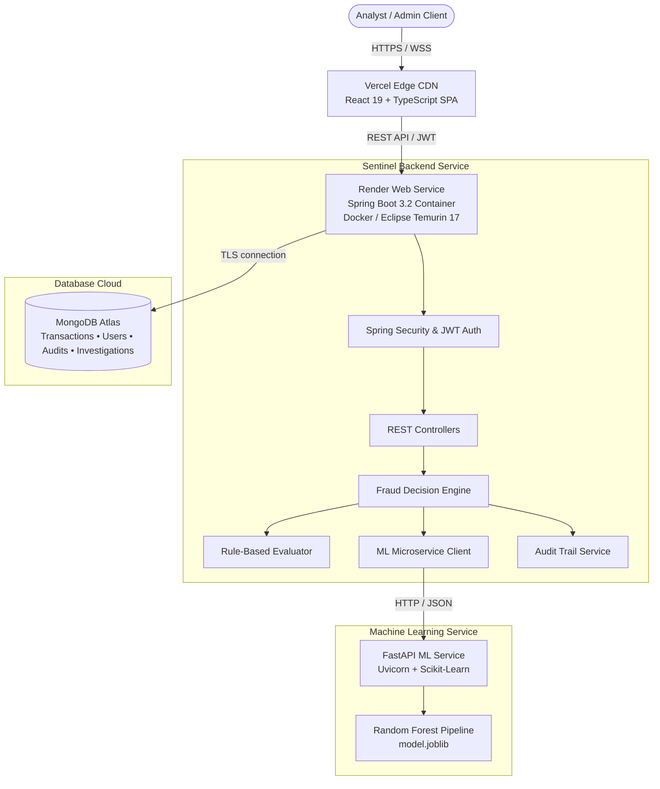

<div align="center">

# 🛡️ SENTINEL
### Automated Rule Engine & Real-Time Fraud Intercept Platform

[](https://openjdk.org/)
[](https://spring.io/projects/spring-boot)
[](https://react.dev/)
[](https://www.typescriptlang.org/)
[](https://www.docker.com/)
[](https://www.mongodb.com/atlas)
[](https://tailwindcss.com/)
[](LICENSE)

<br/>

> **Sentinel** is an enterprise-grade, distributed fraud prevention platform engineered to intercept malicious financial transactions in real time. It unifies high-throughput heuristic rule evaluation, statistical explainability, interactive adversarial simulation sandboxes, and a live cyber-defense telemetry radar.

<br/>

[Key Capabilities](#-key-capabilities) •
[System Architecture](#-system-architecture) •
[Complete Technology Stack](#-complete-technology-stack) •
[Interactive Defense Modules](#-interactive-defense-modules) •
[Deployment Guide](#-production-deployment) •
[Local Quickstart](#-local-quickstart)

</div>

---

## ⚡ Key Capabilities

- **Hybrid Fraud Detection Core**: Seamlessly toggles between deterministic rule-based evaluation, machine learning inference, and an intelligent ensemble scoring pipeline (`RULES_ONLY`, `ML_ONLY`, `HYBRID`).
- **Live Threat Intercept Radar**: Real-time radial spatial mapping of live transaction telemetry, automatically triaging severity into High-Critical, Elevated, and Verified bands with active sweep tracking.
- **Explainable AI (XAI) & SHAP Reasoning**: Transparent mathematical attribution of risk factors using SHAP values (velocity burst, geolocation jumps, device fingerprint mismatches) alongside an interactive decision threshold simulator.
- **Adversarial Fraud Simulation Sandbox**: A dedicated interactive testing workbench (`/sandbox`) allowing fraud analysts to craft custom attack vectors, override telemetry conditions, and trace automated decision tree execution.
- **Enterprise RBAC & Security**: Statistically rate-limited authentication, Argon2/BCrypt hashing, stateless HMAC-SHA signed JWT tokens, and comprehensive audit trail logging.
- **Cloud-Native Deployment**: Containerized with multi-stage Docker builds on **Render** (Backend) and serverless static edge distribution on **Vercel** (Frontend), backed by **MongoDB Atlas**.

---

## 🏛️ System Architecture



---

## 💻 Complete Technology Stack

### 🖥️ Frontend Client Layer
- **Framework & Runtime**: React 19, TypeScript 5+, Vite 8
- **Styling & Design System**: Tailwind CSS v4, Vanilla CSS Glassmorphism tokens, Cyberpunk Defense Palette (HSL Tailored)
- **Animation & Motion**: Framer Motion 14 (spatial micro-interactions, radar pulses, count-up numbers)
- **Data Visualization**: Recharts 3 (SHAP feature attribution waterfall charts, activity area trends, risk distribution pies)
- **Iconography**: Lucide React 1.6+
- **HTTP Client**: Axios with Bearer token request/response interceptors
- **Client Routing**: React Router v7 with protected routes & automatic session validation

### ⚙️ Backend Core Layer
- **Language & Framework**: Java 17 LTS, Spring Boot 3.2.5
- **Security & Authorization**: Spring Security, JJWT (io.jsonwebtoken 0.12.6), BCrypt Password Encoder
- **Database & ODM**: Spring Data MongoDB, MongoDB Atlas Driver
- **Validation**: Hibernate Validator / Spring Boot Starter Validation
- **Logging & Diagnostics**: SLF4J, Logback structured diagnostic logging
- **Build & Dependency Tool**: Apache Maven 3.9+ with Maven Wrapper (`mvnw`)

### 🧠 Machine Learning & Analytics Service
- **Framework**: Python 3.10+, FastAPI, Uvicorn ASGI
- **Machine Learning Core**: Scikit-Learn, NumPy, Pandas, Joblib
- **Modeling Algorithms**: Random Forest Classifier, Dynamic SHAP (SHapley Additive exPlanations) attribution
- **Test Automation**: PyTest

### 🐳 Containerization & Infrastructure
- **Container Engine**: Docker (Multi-stage build using `eclipse-temurin:17-jdk-jammy` and `eclipse-temurin:17-jre-jammy`)
- **Backend Cloud Hosting**: Render Cloud Web Service (Linux Container runtime)
- **Frontend Cloud Hosting**: Vercel Serverless Edge Platform
- **Database Cloud Hosting**: MongoDB Atlas Cloud Cluster (M0/Dedicated Tier)
- **Repository Management**: GitHub CI/CD Actions Ready

---

## 🎯 Interactive Defense Modules

### 1. Defense Command Radar (`LiveThreatRadar`)
Visualizes live transactions in an interactive spatial sweep. The core intercepts critical threats ($>75$ risk score) with glowing pulse animations, while the outer rings monitor verified transactions and regional provenance.

### 2. SHAP Explainability & Threshold Simulator (`AdvancedExplainabilityHub`)
Provides mathematical transparency into why an algorithm flagged a transaction. Features an interactive slider ($30$ to $90$) simulating dynamic precision/recall trade-offs and automated block thresholds.

### 3. Adversarial Simulation Sandbox (`FraudSandboxPage`)
A dedicated laboratory allowing security engineers to launch preset cyber attacks:
- **Velocity Micro-Bursting**: Simulates carding botnets testing stolen credential dumps.
- **Impossible Geolocation Jumps**: Detects spatial anomalies (e.g., European and Asian access points within 15 minutes).
- **Zero-Trust Telemetry Overrides**: Simulates unrecognized browser fingerprints and ASN shifts.

---

## 📂 Repository Structure

```
Sentinel/
├── backend/
│   └── sentinel/                       # Spring Boot Microservice
│       ├── Dockerfile                  # Multi-stage production container build
│       ├── pom.xml                     # Maven configuration & dependencies
│       ├── mvnw / mvnw.cmd             # Maven Wrapper scripts
│       └── src/main/java/com/sentinel/
│           ├── auth/                   # JWT Auth, UserDetails, LoginAttemptService
│           ├── investigation/          # Case management & investigator assignments
│           ├── ml/                     # ML integration client & analytics endpoints
│           ├── FraudDetectionService.java  # Core multi-rule heuristic engine
│           ├── TransactionService.java     # Transaction lifecycle & state transitions
│           ├── AuditLogService.java        # Immutable security audit logging
│           └── SecurityConfig.java         # CORS, CSRF, and filter chain configuration
│
├── frontend/                           # React 19 Single Page Application
│   ├── vercel.json                     # Vercel SPA rewrite & cache control
│   ├── vite.config.ts                  # Vite compilation bundler
│   ├── package.json                    # Dependencies (React, Framer Motion, Recharts)
│   └── src/
│       ├── components/
│       │   ├── dashboard/              # LiveThreatRadar, ExplainabilityHub, ML panels
│       │   ├── layout/                 # DashboardShell, ProtectedRoute, Navigation
│       │   └── ui/                     # RiskGauge, MetricCards, Badges, Modals
│       ├── pages/                      # DashboardOverview, Sandbox, Flagged, AuditLogs
│       └── services/api.ts             # Typed Axios backend integration
│
└── ml-service/                         # Python AI Microservice
    ├── main.py                         # FastAPI REST application
    ├── model.joblib                    # Serialized Random Forest model artifact
    ├── requirements.txt                # Python package manifests
    └── training/train.py               # Reproducible ML training pipeline
```

---

## 🚀 Production Deployment

### 1. Backend on Render (Docker)

1. Create a new **Web Service** on [Render](https://dashboard.render.com) and link the repository.
2. Configure settings:
   - **Root Directory**: `backend/sentinel`
   - **Runtime**: `Docker`
   - **Instance Type**: `Free` or higher
3. Add the following **Environment Variables**:
   ```env
   MONGODB_URI=mongodb+srv://<user>:<password>@cluster.mongodb.net/sentinel?retryWrites=true&w=majority
   JWT_SECRET=c8f93e2b7a419d8540c1e6fb308d27a14589d9e267104bcefa01438a95d73281
   SENTINEL_ADMIN_USERNAME=admin
   SENTINEL_ADMIN_PASSWORD=YourSecurePassword123!
   CORS_ALLOWED_ORIGIN=https://your-frontend.vercel.app,http://localhost:5173
   ```
4. Click **Deploy Web Service**.

### 2. Frontend on Vercel

1. Import the repository into [Vercel](https://vercel.com).
2. Configure settings:
   - **Framework Preset**: `Vite`
   - **Root Directory**: `frontend`
3. Add Environment Variable:
   ```env
   VITE_API_BASE_URL=https://your-backend-service.onrender.com
   ```
4. Click **Deploy**.

---

## 💻 Local Quickstart

### 1. Prerequisites
- **JDK 17** or higher
- **Node.js 18+** & npm
- **Python 3.10+** (optional, for local ML training)
- **MongoDB** running locally on port `27017` or a MongoDB Atlas URI

### 2. Start the Backend
```bash
cd backend/sentinel
./mvnw spring-boot:run
```
*Backend runs on `http://localhost:8080`.*

### 3. Start the Frontend
```bash
cd frontend
npm install
npm run dev
```
*Frontend runs on `http://localhost:5173`.*

### 4. (Optional) Start the Python ML Service
```bash
cd ml-service
pip install -r requirements.txt
uvicorn main:app --host 0.0.0.0 --port 8000 --reload
```

---

## 🔒 Security & Compliance

- **No Hardcoded Secrets**: All keys, passwords, and connection strings are injected via runtime environment variables.
- **Zero-Trust Token Strategy**: Short-lived cryptographic JWT tokens signed with high-entropy HMAC-SHA secrets.
- **Immutable Audit Logging**: Every transaction change, investigator review, and login attempt creates an unalterable chronological audit log stored in MongoDB.
- **Defensive CORS Controls**: Strict origin white-listing preventing cross-site scripting and unauthorized API access.

---

## 📄 License
This project is licensed under the MIT License — see the [LICENSE](LICENSE) file for details.

<div align="center">
  <sub>Engineered with precision for secure financial intelligence. Built by <a href="https://github.com/Nivritha03">Nivritha</a>.</sub>
</div>
